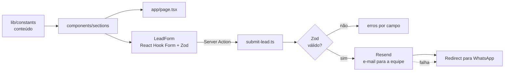

<div align="center">

# VYRO — Site institucional

**Site de alta performance para uma agência de tecnologia e growth focada em clínicas de estética e serviços locais.**


</div>

---

## Visão geral

A VYRO é uma agência que se posiciona em *Tech & Growth*. Este repositório contém o site que funciona como seu principal canal de aquisição: uma one-page com direção de arte "Dark Tech Luxury", conteúdo desacoplado do código e uma captação de leads por Server Action.

O projeto foi conduzido de forma **documentada**: o escopo está em [`PRD.md`](./PRD.md), as decisões técnicas em [`SPECS.md`](./SPECS.md) e o plano de evolução visual em [`VYRO_FRONTEND_IMPLEMENTATION_PLAN.md`](./VYRO_FRONTEND_IMPLEMENTATION_PLAN.md).

## Problema que resolve

Segundo o PRD, pequenos negócios e clínicas de estética investem em marketing genérico que gera cliques, mas não agendamentos qualificados. O site precisa **provar a proposta da agência** (tecnologia focada em conversão) e converter visitantes vindos de anúncios, em sua maioria por mobile, em contatos qualificados via WhatsApp ou e-mail.

## Principais funcionalidades

| Funcionalidade | Detalhes | Onde está |
|---|---|---|
| **One-page por seções** | Hero, Dor, Método, Serviços, Promessas, Resultados, FAQ, CTA e rodapé | `app/page.tsx`, `components/sections/` |
| **Conteúdo desacoplado (CMS-ready)** | Textos, FAQ, serviços, navegação e contatos fora do JSX | `lib/constants/` |
| **Captação de leads** | Formulário com validação Zod compartilhada entre cliente e servidor, *honeypot* e Server Action | `components/sections/lead-form.tsx`, `app/actions/submit-lead.ts`, `lib/schemas.ts` |
| **Notificação por e-mail** | Envio via Resend com HTML escapado | `lib/resend.ts` |
| **Fallback para WhatsApp** | Se o e-mail falhar, o lead é redirecionado para o WhatsApp com a mensagem preenchida | `app/actions/submit-lead.ts` |
| **Diagnóstico interativo** | Questionário em etapas com projeção calculada, que leva ao formulário | `components/sections/diagnostic.tsx`, `lib/constants/diagnostic.ts` |
| **Consentimento (LGPD)** | Banner de cookies; GTM e Pixel da Meta só carregam após consentimento | `components/ui/cookie-banner.tsx`, `components/scripts/analytics.tsx`, `lib/consent.ts` |
| **Animações** | Motion e GSAP com `Reveal`/`ScrollReveal` reutilizáveis | `components/ui/`, `lib/gsap.ts` |
| **SEO básico** | Metadata e Open Graph, `robots.txt`, `sitemap.xml`, imagem OG | `app/layout.tsx`, `public/` |

> **Nota de estado:** os componentes `Diagnostic`, `LeadForm` e `SocialProof` estão implementados, mas **não estão montados** na Home atual (`app/page.tsx`) desde o redesign visual. Para reativar o fluxo completo de captação, basta incluí-los na composição da página.

## Stack

| Camada | Tecnologia |
|---|---|
| Framework | Next.js 15 (App Router, Server Actions) + React 19 |
| Linguagem | TypeScript (checagem estrita) |
| Estilo | Tailwind CSS v4 (tema via `@theme` em `globals.css`) |
| Animação | Motion + GSAP |
| Formulários e validação | React Hook Form + Zod |
| E-mail transacional | Resend |
| Fontes | `next/font` (Archivo, Poppins, Inter) |

## Arquitetura



A aplicação é intencionalmente **stateless**: não há banco de dados no MVP (decisão registrada no SPECS). O lead é encaminhado por e-mail e WhatsApp; a proteção contra abuso fica a cargo da camada de borda do provedor (WAF).

```text
app/
├── actions/submit-lead.ts     # Server Action de captação
├── layout.tsx · page.tsx · globals.css
components/
├── layout/header.tsx
├── sections/                  # hero, pain, method, services, results, faq, cta, lead-form…
├── scripts/analytics.tsx      # GTM + Pixel, condicionados ao consentimento
└── ui/                        # button, card, accordion, cookie-banner, reveal…
lib/
├── constants/                 # conteúdo editável (serviços, FAQ, nav, contato…)
├── schemas.ts                 # schema Zod (fonte única de verdade)
├── resend.ts · consent.ts · gsap.ts · utils.ts
public/                        # og-image, robots.txt, sitemap.xml
```

## Requisitos

- Node.js 20 ou superior
- npm

## Como executar localmente

```bash
git clone https://github.com/Gabriel-serra-eng/VYRO-web.git
cd VYRO-web
npm install
cp .env.example .env.local   # preencha os valores
npm run dev
```

Acesse [http://localhost:3000](http://localhost:3000).

### Variáveis de ambiente

| Variável | Obrigatória | Descrição |
|---|---|---|
| `RESEND_API_KEY` | Para o e-mail de leads | Chave da API Resend — apenas servidor. Sem ela, o fluxo cai direto no fallback do WhatsApp |
| `RESEND_FROM_EMAIL` | Não | Remetente verificado no Resend (padrão: `VYRO <leads@vyro.com.br>`) |
| `LEAD_NOTIFICATION_EMAIL` | Não | Destinatário das notificações (padrão: e-mail em `lib/constants/contact.ts`) |
| `NEXT_PUBLIC_GTM_ID` | Não | ID do Google Tag Manager (só carrega com consentimento) |
| `NEXT_PUBLIC_META_PIXEL_ID` | Não | ID do Pixel da Meta (só carrega com consentimento) |

### Scripts

| Comando | Função |
|---|---|
| `npm run dev` | Servidor de desenvolvimento |
| `npm run build` / `npm run start` | Build e execução de produção |
| `npm run lint` | ESLint |
| `npm run typecheck` | `tsc --noEmit` |

## Testes e validações

- ESLint e `tsc --noEmit` executam sem erros.
- A validação de entrada usa o mesmo schema Zod no cliente e no servidor.
- **Ainda não há testes automatizados** nem pipeline de CI.

## Documentação

| Documento | Conteúdo |
|---|---|
| [`PRD.md`](./PRD.md) | Visão, público, proposta de valor, jornada e objetivos |
| [`SPECS.md`](./SPECS.md) | Arquitetura, stack, segurança, mapa de arquivos |
| [`VYRO_FRONTEND_IMPLEMENTATION_PLAN.md`](./VYRO_FRONTEND_IMPLEMENTATION_PLAN.md) | Direção de arte, tokens, tipografia e princípios de animação |

## Processo de desenvolvimento com IA

O site foi desenvolvido com um fluxo de desenvolvimento assistido por IA. **A aplicação não chama modelos de IA em tempo de execução.**

| Etapa | Ferramenta | Artefato |
|---|---|---|
| 1. Escopo e público | Definidos antes do código | [`PRD.md`](./PRD.md) |
| 2. Decisões técnicas | Especificação para guiar a implementação | [`SPECS.md`](./SPECS.md) |
| 3. Redesign visual | Claude Design | [`VYRO_FRONTEND_IMPLEMENTATION_PLAN.md`](./VYRO_FRONTEND_IMPLEMENTATION_PLAN.md) |
| 4. Implementação | Claude Code | Histórico de commits, com co-autoria registrada |
| 5. Testes de interface pelo agente | Skill `webapp-testing` (Playwright), de terceiros | `.agents/skills/webapp-testing/` |

### Responsabilidades

- **Minhas:** posicionamento da agência, escopo do PRD, conteúdo, aprovação do redesign, regras de consentimento (GTM e Pixel só após aceite).
- **Com assistência de IA:** escrita dos componentes e da Server Action (Claude Code), plano de implementação do redesign.
- **De terceiros:** a skill `webapp-testing` foi incluída como ferramenta do agente; não é de minha autoria.

## Autor

**Gabriel Serra** — [GitHub](https://github.com/Gabriel-serra-eng)
